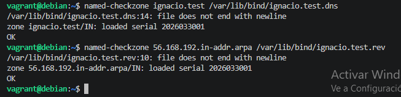
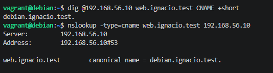
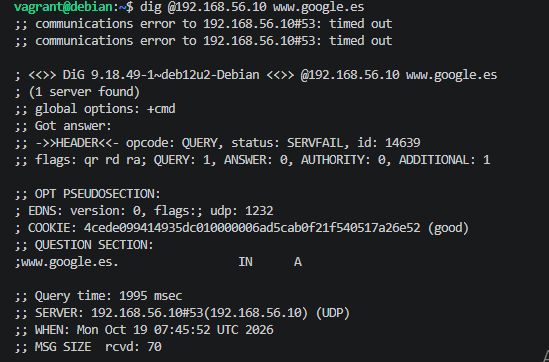
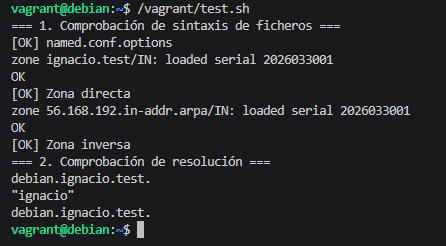

**Autor:** Ignacio García González  
**Asignatura:** Despliegue de Aplicaciones Web

---

## 1. Comprobación de Sintaxis de Archivos y Zonas

Se ha verificado la sintaxis de las configuraciones y ficheros de zona utilizando el comando `named-checkzone`:

---

## 2. Tareas de Ampliación y Comprobación

### 2.1. Registro Alias CNAME
Prueba de resolución del alias `web.ignacio.test` hacia el nombre canónico `debian.ignacio.test`:

### 2.2. Registro Descriptivo TXT
Consulta del registro TXT en la raíz del dominio `ignacio.test`:

### 2.3. Resolución Inversa PTR
Comprobación de la resolución inversa de la IP `192.168.56.10` al FQDN `debian.ignacio.test`:

---

## 3. Comprobación de Autoridad (Flag AA)

Comparativa de la cabecera devuelta al consultar nuestro dominio local frente a un dominio externo (`www.google.es`):

**Justificación del Flag `aa`:**  
El flag `aa` (*Authoritative Answer*) aparece únicamente en la consulta de `debian.ignacio.test` porque nuestro servidor BIND9 es la autoridad maestra responsable de dicha zona local. En cambio, no aparece al consultar `www.google.es` debido a que nuestro servidor actúa únicamente como un intermediario/recursivo obteniendo los datos desde servidores DNS externos.

---

## 4. Script de Autocomprobación (`test.sh`)

Resultado de la ejecución del script `test.sh` ejecutado automáticamente durante la provisión de Vagrant:

